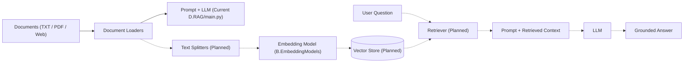

# Generative AI with LangChain

> A hands-on learning workspace for building chat-model integrations,
> embeddings, structured extraction apps, and RAG pipelines with LangChain.

[](https://www.python.org/)
[](https://www.langchain.com/)
[](#current-status)

---

## Table of Contents

- [About](#about)
- [Current Status](#current-status)
- [Learning Roadmap](#learning-roadmap)
- [Available Examples](#available-examples)
- [Tech Stack](#tech-stack)
- [How RAG Fits Together](#how-rag-fits-together)
- [Project Structure](#project-structure)
- [Getting Started](#getting-started)
- [Environment Variables](#environment-variables)
- [Troubleshooting](#troubleshooting)
- [Security Note](#security-note)
- [What I'm Learning](#what-im-learning)
- [Author](#author)

---

## About

This repository is my hands-on workspace for learning **Generative AI
engineering** with LangChain. Instead of only reading documentation, each folder
focuses on small, runnable experiments—from calling hosted and local LLMs to
preserving chat history, generating vector embeddings, extracting Pydantic-validated
data, and loading external documents for Retrieval-Augmented Generation (RAG).

---

## Current Status

This repository is actively in progress and organized into numbered learning
modules (`A` through `D`), moving from chat models and embeddings to structured
extraction apps and RAG document loaders.

### Implemented

- Multi-provider chat model examples using Groq (`init_chat_model`) and Google
  Gemini (`ChatGoogleGenerativeAI`) in `A.Chatmodels/chat.py`
- A Hugging Face hosted inference example (`HuggingFaceEndpoint` +
  `ChatHuggingFace`) in `A.Chatmodels/huggingface.py`
- A local TinyLlama text-generation example (`HuggingFacePipeline`) in
  `A.Chatmodels/loalmodel.py`
- An interactive Groq terminal chatbot with selectable persona modes and
  LangChain message history in `A.Chatmodels/chatbot.py`
- A Streamlit chatbot UI with mode selection and `st.session_state` memory in
  `A.Chatmodels/ChatbotUI.py`
- A Google Gemini embedding example (`gemini-embedding-2`, 768 dimensions) in
  `B.EmbeddingModels/embeddings.py`
- A local Sentence Transformers embedding example (`all-MiniLM-L6-v2`) in
  `B.EmbeddingModels/huggingface_embedding.py`
- **CineSage**, a movie-information extraction module with:
  - A CLI Pydantic-structured extractor in `C.CineSage/core.py`
  - A free-text Streamlit Movie Information Assistant in
    `C.CineSage/UICineSage1.py`
  - A JSON-formatted Streamlit Movie Information Extractor in
    `C.CineSage/UICineSage2.py`
- RAG document-loader experiments for plain text (`TextLoader`), PDFs
  (`PyPDFLoader`), and web pages (`WebBaseLoader`) in `D.RAG/Document_Loaders/`
- RAG architecture and concept study notes in
  `D.RAG/Document_Loaders/RAG noted GROQ.txt`
- A multi-source document loading and Groq summarization script in `D.RAG/main.py`
- Environment variable management with `python-dotenv` and VS Code terminal
  `.env` support in `.vscode/settings.json`
- Full dependency specification in `requirements.txt` covering LangChain,
  LangGraph, vector stores, text splitters, rerankers, FastAPI, and Streamlit

### Planned / Future Extensions

- Text splitting strategies (`CharacterTextSplitter`,
  `RecursiveCharacterTextSplitter`, `TokenTextSplitter`)
- Vector databases and semantic retrieval (`Chroma`, `FAISS`, `pgvector`, BM25)
- End-to-end RAG question-answering pipelines and UIs
- LangChain Expression Language (LCEL) runnables, tool calling, and LangGraph
  agents
- Backend API serving with FastAPI and Uvicorn

---

## Learning Roadmap

- [x] **Chat models:** `init_chat_model`, provider classes, temperature/timeout
  configuration, and hosted vs. local inference
- [x] **Chatbot interfaces:** Terminal and Streamlit interfaces with
  `SystemMessage`, `HumanMessage`, and `AIMessage` history
- [x] **Structured extraction (CineSage):** Prompt templates, Pydantic models,
  and `PydanticOutputParser` across CLI and Streamlit UIs
- [x] **Embeddings:** Cloud (`gemini-embedding-2`) and local
  (`sentence-transformers/all-MiniLM-L6-v2`) text embeddings
- [x] **RAG — Document loaders:** Loading text files, PDFs, and web pages into
  LangChain `Document` objects
- [ ] **RAG — Text splitters & vector stores:** Chunking documents and indexing
  vectors into Chroma / FAISS
- [ ] **RAG — Retrieval & Q&A:** Similarity/MMR retrieval connected to an LLM
  generation pipeline
- [ ] **Runnables, tool calling & agents:** Composable LCEL chains, custom
  tools, and LangGraph agent workflows
- [ ] **API serving:** Exposing LangChain pipelines with FastAPI

---

## Available Examples

### 1. Chat Models (`A.Chatmodels/`)

#### Multi-provider chat models

[`A.Chatmodels/chat.py`](A.Chatmodels/chat.py) demonstrates the two main ways
to initialize chat models in LangChain:

- `init_chat_model` with Groq (`groq:openai/gpt-oss-120b`, `temperature=0.7`)
- `ChatGoogleGenerativeAI` with Google Gemini (`gemini-3.8-flash`, `timeout=40`)

Run from the repository root:

```bash
python A.Chatmodels/chat.py
```

Requires `GROQ_API_KEY` (and see [Environment Variables](#environment-variables)
for the trailing-space note on `GOOGLE_API_KEY ` in this script).

#### Hugging Face hosted model

[`A.Chatmodels/huggingface.py`](A.Chatmodels/huggingface.py) wraps
`HuggingFaceEndpoint` (`repo_id="deepseek-ai/DeepSeek-V4.1-Flash-1017"`) in
`ChatHuggingFace` and invokes it with a prompt.

Run it with:

```bash
python A.Chatmodels/huggingface.py
```

Requires `HUGGINGFACEHUB_ACCESS_TOKEN`.

#### Local Hugging Face model

[`A.Chatmodels/loalmodel.py`](A.Chatmodels/loalmodel.py) runs
`TinyLlama/TinyLlama-1.1B-Chat-v0.1` locally using
`HuggingFacePipeline.from_model_id` for `text-generation` (`max_new_tokens=512`,
`do_sample=False`, `repetition_penalty=1.03`, `return_full_text=False`).

Run it with:

```bash
python A.Chatmodels/loalmodel.py
```

No API key is required; the model weights are downloaded and cached locally on
first run.

#### Interactive Groq terminal chatbot

[`A.Chatmodels/chatbot.py`](A.Chatmodels/chatbot.py) provides an interactive
terminal chatbot backed by `ChatGroq` (`openai/gpt-oss-120b`). It preserves
short-term conversation memory using `SystemMessage`, `HumanMessage`, and
`AIMessage`, lets you choose a persona mode at startup (**1:** Angry,
**2:** Funny, **3:** Sad, or fallback simple chatbot), and exits when you
enter `0`.

Run it with:

```bash
python A.Chatmodels/chatbot.py
```

Requires Groq credentials in `.env` (see
[Environment Variables](#environment-variables) regarding `GROQ_API_KEY `).

#### Streamlit chatbot UI

[`A.Chatmodels/ChatbotUI.py`](A.Chatmodels/ChatbotUI.py) wraps the Groq
chatbot (`openai/gpt-oss-120b`) in a Streamlit web interface. Features include:

- Mode selector (`Angry mode`, `Funny mode`, `Sad mode`, `Simple chatbot`)
- Session-state persistence (`st.session_state.messages`) across reruns
- Chat bubbles via `st.chat_message` and `st.chat_input`
- Entering `0` ends the active session until the page is refreshed

Start the app with:

```bash
streamlit run A.Chatmodels/ChatbotUI.py
```

Requires `GROQ_API_KEY` and a browser.

---

### 2. Embedding Models (`B.EmbeddingModels/`)

#### Google Gemini embeddings

[`B.EmbeddingModels/embeddings.py`](B.EmbeddingModels/embeddings.py) uses
`GoogleGenerativeAIEmbeddings` (`model="gemini-embedding-2"`,
`output_dimensionality=768`) to demonstrate both:

- `embed_query()` for a single query string
- `embed_documents()` for a list of documents

Run it with:

```bash
python B.EmbeddingModels/embeddings.py
```

Requires `GOOGLE_API_KEY`.

#### Local Hugging Face embeddings

[`B.EmbeddingModels/huggingface_embedding.py`](B.EmbeddingModels/huggingface_embedding.py)
uses `HuggingFaceEmbeddings` with
`sentence-transformers/all-MiniLM-L6-v2` to embed documents locally without an
API key.

Run it with:

```bash
python B.EmbeddingModels/huggingface_embedding.py
```

---

### 3. CineSage — Movie Information Extraction (`C.CineSage/`)

All CineSage modules use `ChatGroq` (`openai/gpt-oss-120b`) and require
`GROQ_API_KEY`.

#### CLI structured extractor

[`C.CineSage/core.py`](C.CineSage/core.py) defines a Pydantic `Movie` schema
(`title`, `release_year`, `genre`, `director`, `cast`, `rating`, `summary`) and
uses `PydanticOutputParser` with `ChatPromptTemplate` to extract and validate
structured movie details from a user-provided paragraph.

Run it with:

```bash
python C.CineSage/core.py
```

#### Streamlit Movie Information Assistant (`UICineSage1`)

[`C.CineSage/UICineSage1.py`](C.CineSage/UICineSage1.py) is a Streamlit UI
that uses a `ChatPromptTemplate` to summarize a movie paragraph into Movie
Name, Genre, Director, Main Cast, Release Year, Plot Summary, and Language
(returning `Unknown` for missing details).

Start it with:

```bash
streamlit run C.CineSage/UICineSage1.py
```

#### Streamlit Structured JSON Extractor (`UICineSage2`)

[`C.CineSage/UICineSage2.py`](C.CineSage/UICineSage2.py) combines the Pydantic
`Movie` schema and `PydanticOutputParser` with a Streamlit interface, displaying
the extracted output in a formatted JSON code block (`st.code(..., language="json")`).

Start it with:

```bash
streamlit run C.CineSage/UICineSage2.py
```

---

### 4. RAG & Document Loaders (`D.RAG/`)

#### Individual document loaders

The [`D.RAG/Document_Loaders/`](D.RAG/Document_Loaders/) folder contains
isolated loader examples and sample source documents:

- [`text.py`](D.RAG/Document_Loaders/text.py) — Loads
  [`RAG noted GROQ.txt`](D.RAG/Document_Loaders/RAG%20noted%20GROQ.txt) with
  `TextLoader` (`encoding="utf-8"`) and prints `docs[0].page_content`.
- [`pdf.py`](D.RAG/Document_Loaders/pdf.py) — Loads
  [`Chapter9IntroductiontoMLRegression1_985a1194-056b-43c1-af86-bfa0dca9969a_268917_.pdf`](D.RAG/Document_Loaders/Chapter9IntroductiontoMLRegression1_985a1194-056b-43c1-af86-bfa0dca9969a_268917_.pdf)
  with `PyPDFLoader` and prints `docs[21].page_content`.
- [`page.py`](D.RAG/Document_Loaders/page.py) — Loads a web page with
  `WebBaseLoader` and prints `docs[0].page_content`.

Run them from the repository root:

```bash
python D.RAG/Document_Loaders/text.py
python D.RAG/Document_Loaders/pdf.py
python D.RAG/Document_Loaders/page.py
```

> [!NOTE]
> `text.py`, `pdf.py`, and `D.RAG/main.py` currently reference absolute Windows
> paths (`C:\Users\prafu\Music\Generative-AI\...`). Update those paths if you
> clone the repository to another location or OS. `page.py` requires an active
> internet connection.

#### Combined loader + summarization pipeline

[`D.RAG/main.py`](D.RAG/main.py) brings together `TextLoader`, `PyPDFLoader`,
and `WebBaseLoader`, inserts loaded `page_content` into a `ChatPromptTemplate`
summarization prompt, and invokes `ChatGroq` (`openai/gpt-oss-120b`) on the
loaded web page document (`prompturl`).

Run it with:

```bash
python D.RAG/main.py
```

Requires `GROQ_API_KEY`, internet access, and valid paths to the sample text and
PDF files.

---

## Tech Stack

### Currently Used

- **Language:** Python 3.12+ (developed with Python 3.14.6)
- **Framework:** LangChain (`langchain`, `langchain-core`, `langchain-community`)
- **LLM Providers:** Groq (`langchain-groq`), Google Gemini
  (`langchain-google-genai`), Hugging Face (`langchain-huggingface`)
- **Local Inference & Embeddings:** `transformers`, `sentence-transformers`
- **Document Loaders:** `TextLoader`, `PyPDFLoader` (`pypdf`), `WebBaseLoader`
  (`beautifulsoup4`)
- **Structured Output:** `pydantic`, `PydanticOutputParser`
- **Web UI:** `streamlit`
- **Configuration:** `python-dotenv`

### Ready in `requirements.txt` for Upcoming Modules

- **Text Splitting & Tokenization:** `langchain-text-splitters`,
  `langchain-classic`, `tiktoken`
- **Vector Stores:** `chromadb`, `langchain-chroma`, `faiss-cpu`,
  `langchain-postgres`, `pgvector`
- **Retrieval & Reranking:** `rank-bm25`, `cohere`
- **Additional Document Loaders:** `pymupdf`, `python-docx`, `docx2txt`, `lxml`,
  `unstructured`
- **Agent Orchestration & Tracing:** `langgraph`, `langsmith`
- **Additional Providers:** `langchain-openai`, `langchain-mistralai`
- **Backend & Database:** `fastapi`, `uvicorn`, `python-multipart`, `requests`,
  `sqlalchemy`, `psycopg[binary]`

---

## How RAG Fits Together

The current `D.RAG` module implements **Document Loading -> Prompt -> LLM
Summarization**, while the full RAG architecture being built in this workspace
follows this flow:



---

## Project Structure

```text
Generative-AI/
├── A.Chatmodels/
│   ├── chat.py                     # Groq (init_chat_model) & Gemini examples
│   ├── chatbot.py                  # Interactive Groq terminal chatbot with modes
│   ├── ChatbotUI.py                # Streamlit Groq chatbot UI
│   ├── huggingface.py              # Hugging Face hosted endpoint (DeepSeek)
│   └── loalmodel.py                # Local TinyLlama HuggingFacePipeline example
├── B.EmbeddingModels/
│   ├── embeddings.py               # Google Gemini embeddings (768-dim)
│   └── huggingface_embedding.py    # Local all-MiniLM-L6-v2 embeddings
├── C.CineSage/
│   ├── core.py                     # CLI Pydantic movie extractor
│   ├── UICineSage1.py              # Streamlit Movie Information Assistant
│   └── UICineSage2.py              # Streamlit JSON Movie Information Extractor
├── D.RAG/
│   ├── Document_Loaders/
│   │   ├── Chapter9IntroductiontoMLRegression1_985a1194-056b-43c1-af86-bfa0dca9969a_268917_.pdf
│   │   ├── page.py                 # WebBaseLoader example
│   │   ├── pdf.py                  # PyPDFLoader example
│   │   ├── RAG noted GROQ.txt      # RAG architecture & pipeline study notes
│   │   └── text.py                 # TextLoader example
│   └── main.py                     # Document loading + Groq summarization
├── .vscode/
│   └── settings.json               # Enables .env loading in VS Code terminal
├── .env                            # Local API keys (git-ignored, create locally)
├── .gitignore
├── README.md
└── requirements.txt                # Project dependencies
```

---

## Getting Started

### Prerequisites

- Python 3.12 or newer (tested with Python 3.14.6)
- Git
- API keys for hosted providers you intend to run (`GROQ_API_KEY`,
  `GOOGLE_API_KEY`, `HUGGINGFACEHUB_ACCESS_TOKEN`)
- A browser for the Streamlit apps (`ChatbotUI.py`, `UICineSage1.py`,
  `UICineSage2.py`)
- Internet access for `WebBaseLoader` (`page.py`, `D.RAG/main.py`) and initial
  Hugging Face model downloads
- Sufficient disk space and memory for local models (`TinyLlama` and
  `all-MiniLM-L6-v2`)

### Installation

1. Clone the repository:

```bash
git clone https://github.com/praful011-nep/Generative-AI.git
cd Generative-AI
```

2. Create and activate a virtual environment:

```bash
python -m venv .venv
```

```powershell
# Windows PowerShell
.venv\Scripts\Activate.ps1
```

```bash
# macOS/Linux
source .venv/bin/activate
```

3. Install dependencies:

```bash
pip install -r requirements.txt
```

4. Create a `.env` file in the repository root and add your API keys (without
   extra quotes):

```dotenv
GROQ_API_KEY=your_groq_api_key
GOOGLE_API_KEY=your_google_api_key
HUGGINGFACEHUB_ACCESS_TOKEN=your_huggingface_token
```

### Run the Examples

With your `.venv` activated from the repository root:

```bash
# Chat models & chatbots
python A.Chatmodels/chat.py
python A.Chatmodels/huggingface.py
python A.Chatmodels/loalmodel.py
python A.Chatmodels/chatbot.py
streamlit run A.Chatmodels/ChatbotUI.py

# Embeddings
python B.EmbeddingModels/embeddings.py
python B.EmbeddingModels/huggingface_embedding.py

# CineSage movie extraction
python C.CineSage/core.py
streamlit run C.CineSage/UICineSage1.py
streamlit run C.CineSage/UICineSage2.py

# RAG document loaders & summarization
python D.RAG/Document_Loaders/text.py
python D.RAG/Document_Loaders/pdf.py
python D.RAG/Document_Loaders/page.py
python D.RAG/main.py
```

---

## Environment Variables

Create a `.env` file in the repository root (already listed in
[`.gitignore`](.gitignore)). The examples reference these variables:

| Variable | Used By | Purpose |
|---|---|---|
| `GROQ_API_KEY` | `A.Chatmodels/chat.py`, `chatbot.py`, `ChatbotUI.py`, `C.CineSage/*`, `D.RAG/main.py` | Groq chat completions (`openai/gpt-oss-120b`) |
| `GOOGLE_API_KEY` | `A.Chatmodels/chat.py`, `B.EmbeddingModels/embeddings.py` | Google Gemini chat (`gemini-3.8-flash`) & embeddings (`gemini-embedding-2`) |
| `HUGGINGFACEHUB_ACCESS_TOKEN` | `A.Chatmodels/huggingface.py` | Hugging Face Inference API authentication |

> [!IMPORTANT]
> Two scripts currently pass a trailing space in `os.getenv(...)`:
> - `A.Chatmodels/chat.py` reads `os.getenv("GOOGLE_API_KEY ")`
> - `A.Chatmodels/chatbot.py` reads `os.getenv("GROQ_API_KEY ")`
>
> Remove the trailing space in those lines if your `.env` uses standard
> `GOOGLE_API_KEY` / `GROQ_API_KEY` names and authentication fails.

The local examples in `A.Chatmodels/loalmodel.py` and
`B.EmbeddingModels/huggingface_embedding.py` run locally and do not require API
keys.

---

## Troubleshooting

### Authentication & Environment Variable Errors

- Confirm `.env` exists in the repository root and has no stray quotes around
  keys.
- Check for the trailing-space lookups noted above (`GOOGLE_API_KEY ` in
  [`A.Chatmodels/chat.py`](A.Chatmodels/chat.py) and `GROQ_API_KEY ` in
  [`A.Chatmodels/chatbot.py`](A.Chatmodels/chatbot.py)).
- Ensure [`A.Chatmodels/huggingface.py`](A.Chatmodels/huggingface.py) uses
  `HUGGINGFACEHUB_ACCESS_TOKEN` (not `HUGGINGFACEHUB_API_TOKEN`).

### Hardcoded Windows Paths in `D.RAG`

[`D.RAG/Document_Loaders/text.py`](D.RAG/Document_Loaders/text.py),
[`D.RAG/Document_Loaders/pdf.py`](D.RAG/Document_Loaders/pdf.py), and
[`D.RAG/main.py`](D.RAG/main.py) use absolute Windows file paths pointing to
`C:\Users\prafu\Music\Generative-AI\...`. Update those paths to relative paths
or your local directory if running on another machine or OS.

### Provider or Model Name Errors

Hosted model identifiers evolve over time. If a provider rejects a model ID
(such as `gemini-3.8-flash`, `deepseek-ai/DeepSeek-V4.1-Flash-1017`,
`openai/gpt-oss-120b`, or `gemini-embedding-2`), check the provider's current
model catalog and update the string in the corresponding script.

### Local Hugging Face Model Downloads

`A.Chatmodels/loalmodel.py` and `B.EmbeddingModels/huggingface_embedding.py`
download model weights on first execution. If they fail, check internet access,
free disk space, available RAM, and your `transformers` / PyTorch installation.

### Structured Output Parsing Errors (`CineSage`)

In `C.CineSage/core.py` and `C.CineSage/UICineSage2.py`, if `PydanticOutputParser`
raises a parsing error, test with a clearer movie description or inspect
`response.content` before parsing to confirm valid JSON output.

### Streamlit or Virtual Environment Issues

Make sure `.venv` is activated and commands are run from the repository root:

```bash
pip install -r requirements.txt
streamlit run A.Chatmodels/ChatbotUI.py
```

---

## Security Note

**Never commit `.env` or any real API key.** The `.env` file is ignored by
[`.gitignore`](.gitignore). If a secret is ever committed by mistake, rotate
and revoke the key immediately in your provider dashboard—simply deleting it in
a later commit does not remove it from Git history.

---

## What I'm Learning

- Initializing and comparing hosted vs. local chat models in LangChain
- Preserving conversation memory with `SystemMessage`, `HumanMessage`, and
  `AIMessage`
- Building interactive AI interfaces with Streamlit
- Generating cloud and local vector embeddings
- Enforcing structured LLM outputs using Pydantic and `PydanticOutputParser`
- Loading text, PDF, and web documents into LangChain `Document` objects for RAG

---

## Author

**Praful Dhakal**

- GitHub: [@praful011-nep](https://github.com/praful011-nep)
